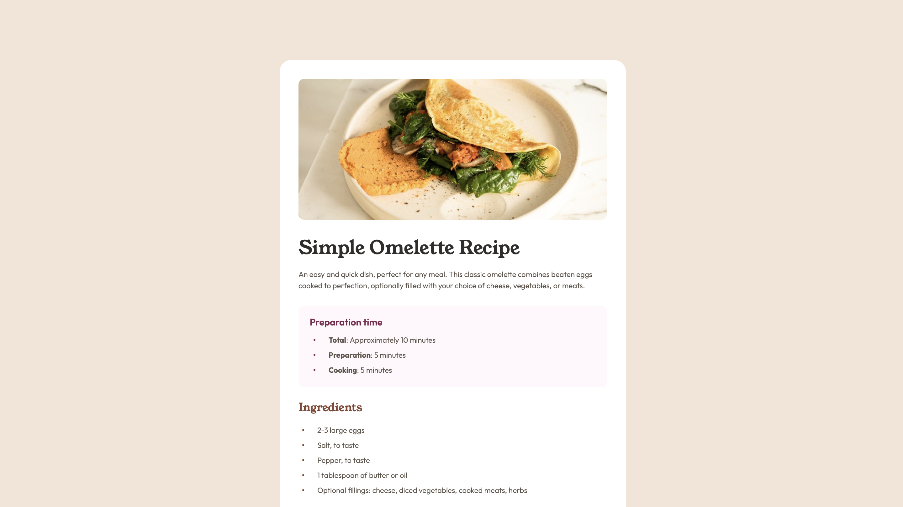

# Frontend Mentor - Recipe page solution

This is a solution to the [Recipe page challenge on Frontend Mentor](https://www.frontendmentor.io/challenges/recipe-page-KiTsR8QQKm). Frontend Mentor challenges help you improve your coding skills by building realistic projects.  

## Table of contents

- [Overview](#overview)
  - [The challenge](#the-challenge)
  - [Screenshot](#screenshot)
  - [Links](#links)
- [My process](#my-process)
  - [Built with](#built-with)
  - [What I learned](#what-i-learned)
  - [Continued development](#continued-development)
  - [Useful resources](#useful-resources)
  - [AI Collaboration](#ai-collaboration)
- [Author](#author)

## Overview

### The challenge

Build a responsive recipe page that closely matches the provided design.

Users should be able to:

- View an optimal layout for their device's screen size.
- Read clearly organized recipe sections, including preparation time, ingredients, instructions, and nutritional information.

The page uses a full-width layout on mobile and a centered card on larger screens. Media queries at `640px` and `1024px` adjust the card width, spacing, typography, and corner rounding to match the tablet and desktop designs.

### Screenshot




### Links

- Solution URL: [Recipe page](https://miliniul.github.io/recipe-page/)

## My process

### Built with

- Semantic HTML5 markup
- CSS custom properties
- Flexbox
- Mobile-first workflow

### What I learned

I learned how to create custom list markers with the `::before` pseudo-element. For the ingredients and preparation lists, I replaced the default bullets with small circles and used Flexbox to control the spacing between each marker and its text. Setting `flex-shrink: 0` keeps the markers from shrinking when the text wraps.

For the instructions, I practiced using CSS counters to generate step numbers automatically:

```css
ol {
    counter-reset: instructions;
}

ol li {
    counter-increment: instructions;
}

ol li::before {
    content: counter(instructions) ".";
    flex-shrink: 0;
    font-weight: 800;
    color: #854632;
}
```

I also learned how to style a nutrition table using `border-collapse: collapse` and structural pseudo-classes. With `:first-child` and `:last-child`, I applied different padding to the label and value columns. Using `:not(:last-child)` allowed me to add separators between rows without adding a border below the final row.

### Continued development

My next step is to test how this recipe page handles longer content and increased text sizes. I plan to replace some ingredients and instructions with longer examples, then check the layout at a narrow viewport width of `320px` and at `200%` browser zoom.

I want to verify that custom bullets and step numbers stay aligned with their text, the nutrition table remains readable, and no content causes horizontal scrolling. If I find problems, I will adjust the spacing and sizing rules, then repeat the same tests to check whether the changes resolve them.

### Useful resources

- [Doka](https://doka.guide/) — A community-driven resource in Russian with clear explanations and practical examples of HTML, CSS, and JavaScript. Useful for understanding layout techniques and reviewing the basics.
- [MDN Web Docs](https://developer.mozilla.org/en-US/) — Comprehensive documentation and guides for web technologies. A helpful reference for checking syntax, exploring CSS properties, and learning JavaScript.

### AI Collaboration

I used Perplexity to find learning resources and explore HTML and CSS concepts while working on this project. It helped me understand Flexbox, how to add custom fonts, and how to manage spacing between elements.

I used it as a learning aid, testing the suggestions in my project to better understand how they worked.

## Author

- Frontend Mentor - [@miliniul](https://www.frontendmentor.io/profile/miliniul)
